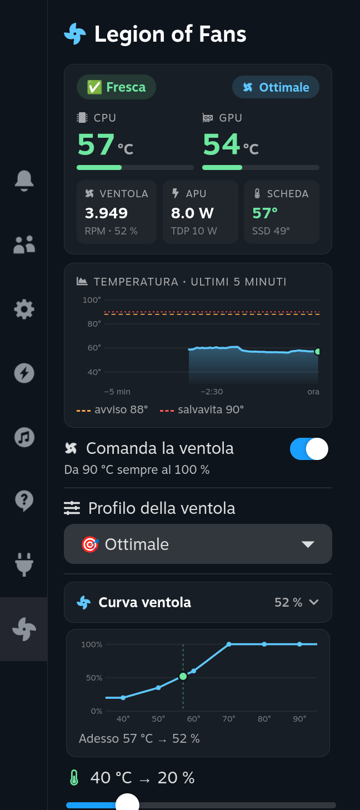
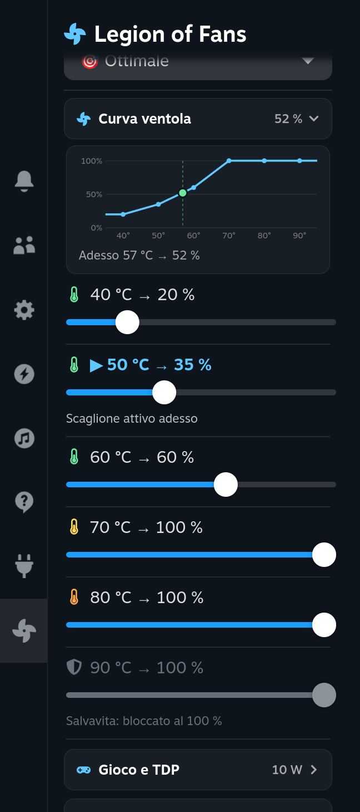
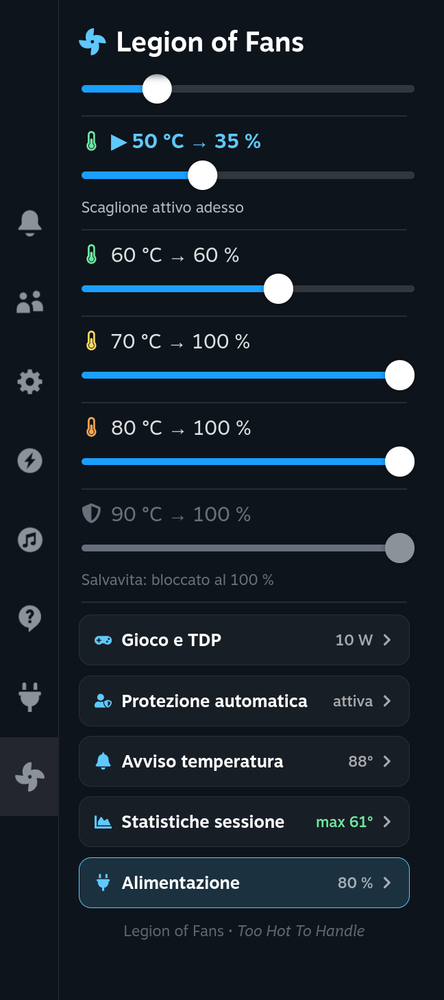
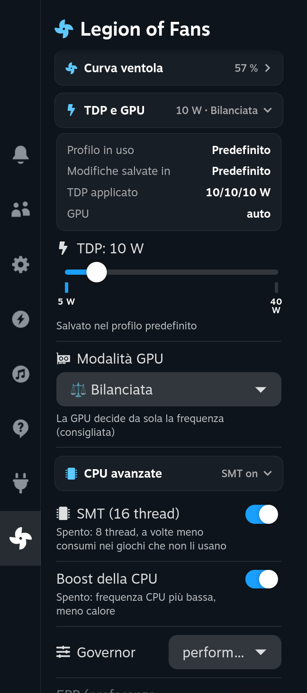
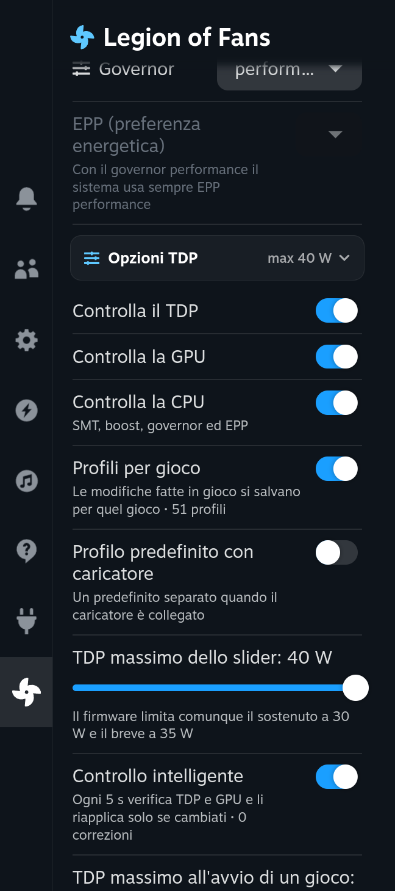

# Legion of Fans — *Too Hot To Handle*

Plugin [Decky Loader](https://decky.xyz/) per la **Lenovo Legion Go originale (83E1)** su Bazzite / SteamOS: ventola, temperature, **TDP, GPU e CPU per gioco**, statistiche e protezione dal surriscaldamento, tutto in un unico punto del menu laterale di Steam.

> **English:** Decky Loader plugin for the original Lenovo Legion Go (83E1). Step-based fan curve driven through the embedded controller, per-game TDP / GPU / CPU profiles (a Legion Go–only replacement for SimpleDeckyTDP, with automatic import), live temperatures, a 5-minute chart, per-game session stats, an optional gradual TDP protection and the firmware 80 % charge limit. The UI is in Italian.

<p>
  
  
  
</p>
<p>
  
  
</p>

## Funzioni

- **Scheda dedicata nel menu laterale** (accanto all'icona di Decky), oltre alla voce nella lista dei plugin.
- **Situazione a colpo d'occhio**: temperatura CPU e GPU con barre colorate e stato testuale (✅ Fresca, 🙂 Tiepida, ⚠️ Calda, 🔥 Critica), giri ventola, potenza APU, TDP, scheda e SSD.
- **Grafico degli ultimi 5 minuti** con le soglie di avviso e salvavita.
- **Curva della ventola a scaglioni** (40–90 °C ogni 10 °C) regolabile con il pad, con mini grafico e **scaglione attivo evidenziato**.
- **Profili**: 🤫 Silenziosa, ⚖️ Bilanciata, 🎯 Ottimale, 🚀 Massima, 🤖 **Automatica** (reagisce a quanto in fretta sale la temperatura e al carico dell'APU), 🛠️ Personalizzata.
- **Salvavita**: da 90 °C, o se la temperatura non è leggibile, ventola sempre al 100 %.
- **TDP e GPU per gioco** (sostituisce [SimpleDeckyTDP](https://github.com/aarron-lee/SimpleDeckyTDP) sulla Legion Go):
  - TDP da 5 W al massimo scelto (fino a 40 W), scritto sui tre limiti del firmware entro i rispettivi massimi (sostenuto 30, breve 35, picco 41 W);
  - GPU 🔋 Batteria, ⚖️ Bilanciata, ↔️ Intervallo (min/max MHz), 📌 Fissa;
  - profili per gioco salvati automaticamente quando cambi qualcosa in gioco, predefinito e predefinito con caricatore;
  - **CPU avanzate**: SMT, boost, governor, EPP;
  - opzioni: TDP massimo all'avvio di un gioco, comportamento al risveglio, SMT prima della sospensione;
  - **controllo intelligente**: riapplica i valori solo se qualcosa li ha cambiati (nessuna scrittura ogni 15 s);
  - **import automatico** dei profili di SimpleDeckyTDP al primo avvio.
- **Protezione automatica** (facoltativa): −3 W ogni *N* minuti sopra la soglia (minimo 15 W), +3 W dopo *N* minuti al fresco; freno di emergenza immediato a 92 °C.
- **Avviso**: notifica di Steam se la temperatura resta sopra la soglia per 10 secondi.
- **Statistiche della sessione**: massima, media, tempo sopra 85/90 °C, ventola e potenza massime, tagli di potenza del firmware, interventi della protezione. Si azzerano quando cambi gioco.
- **Alimentazione**: stato del caricatore e della batteria, **limite di carica all'80 %** (modalità `Long_Life` del firmware Lenovo) con interruttore.

## Requisiti

- Lenovo Legion Go **83E1** (prima generazione). Su altri modelli il plugin resta in sola lettura.
- [Decky Loader](https://decky.xyz/) su Bazzite o SteamOS.
- Non usarlo insieme ad altri plugin che comandano ventola o TDP (es. Panel de Control, SimpleDeckyTDP): importa i profili di SimpleDeckyTDP e poi disattivalo, oppure spegni "Controlla il TDP" nelle Opzioni TDP.

## Installazione

1. Scarica lo zip dalla pagina [Releases](../../releases), oppure compilalo (vedi sotto).
2. In Decky: **Impostazioni → Generali → Modalità sviluppatore**, poi **Sviluppatore → Installa plugin da ZIP**.

## Come funziona

La Legion Go non espone la ventola ai driver Linux (`lenovo_wmi_other: fan reporting/tuning is unsupported on this device`). Il plugin usa direttamente la **tabella ventola a 10 gradini dell'embedded controller**, nella finestra di memoria `0xFE0B0000` (via `/dev/mem`):

| Offset | Significato |
|---|---|
| `+0x30E` (`SFNT`) | 1 = l'EC segue la tabella personalizzata, 0 = curva del firmware |
| `+0x930` | 10 byte: percentuale ventola per gradino |
| `+0x38B` | giri ventola, 16 bit little-endian |

La tabella è indicizzata da un sensore della scheda più freddo dell'APU, quindi il plugin calcola la percentuale dalla temperatura più alta tra CPU (`k10temp Tctl`) e GPU (`amdgpu edge`) e la scrive in tutti i gradini, senza mai scendere sotto i minimi del firmware sui gradini caldi. Ogni secondo rilegge e, se il firmware ha azzerato `SFNT` (succede ad esempio al cambio di profilo energetico), la riattiva. Quando spegni il controllo, disinstalli il plugin o si verifica un errore, la ventola torna al firmware.

Gli indirizzi sono quelli del DSDT della Legion Go (metodo `GZFD.SFAN`), gli stessi usati da [Panel de Control](https://github.com/Hooandee/panel-de-control): grazie a quel progetto per averli documentati.

### Perché la CPU segna qualche grado in più dell'overlay di Steam

L'overlay (MangoHud) mostra la **media delle temperature dei core** letta dalle metriche dell'SMU. Legion of Fans mostra **Tctl**, il sensore di controllo che il firmware usa per throttling e protezioni: di solito è 2–5 °C più alto, ed è il valore più prudente per comandare la ventola.

### TDP sulla Legion Go

Il TDP passa dal profilo energetico Lenovo `custom` (`lenovo-wmi-gamezone`) e dai tre limiti di `lenovo-wmi-other` (`ppt_pl1_spl`, `ppt_pl2_sppt`, `ppt_pl3_fppt`): lo stesso valore viene scritto su tutti e tre, ciascuno limitato al proprio massimo del firmware. La GPU usa `power_dpm_force_performance_level` (`low` / `auto` / `manual`) e, in manuale, `pp_od_clk_voltage`.

### Il caricatore

Linux espone solo la corrente USB-PD negoziata (es. 3,25 A), non la tensione né la potenza in ingresso: la potenza del caricatore è quindi una stima a 20 V.

> ⚠️ Accesso non ufficiale all'hardware e funzionamento come root: usalo a tuo rischio.

## Sviluppo

```bash
pnpm install
pnpm run build
```

Copia e installazione su una Legion Go via SSH:

```bash
LEGION_HOST=utente@legion-go.local scripts/push.sh
```

```bash
ssh -t utente@legion-go.local 'sudo bash ~/legion-fan-stage/deploy.sh ~/legion-fan-stage'
```

Il menu laterale di Steam è una finestra separata: gli stili sono renderizzati dentro il pannello (`src/styles.tsx`), non iniettati nel documento principale.

### Strumenti

| File | A cosa serve |
|---|---|
| `tools/cef.mjs` | Collegamento al debugger remoto di Steam via tunnel SSH: elenca le finestre, esegue JavaScript e cattura screenshot del pannello. |
| `tools/thermal-logger.sh` + `.service` | Servizio utente che registra ogni 5 s temperature, potenze, TDP e giri in `~/thermal-log/AAAA-MM-GG.csv` (scritto su disco riga per riga, utile per capire uno spegnimento improvviso). |
| `tools/sdtdp-25w.py` | Imposta in blocco i profili di SimpleDeckyTDP (Home 10 W, giochi 25 W). |
| `tools/legacy/` | Script usati con Panel de Control prima di questo plugin (curve ventola, limite di carica, orologio). |

La storia del progetto, dalla diagnosi degli spegnimenti al plugin, è in [docs/STORIA.md](docs/STORIA.md). Le modifiche versione per versione sono nel [CHANGELOG](CHANGELOG.md).

## Licenza

BSD-3-Clause (vedi [LICENSE](LICENSE)), basato sul [decky-plugin-template](https://github.com/SteamDeckHomebrew/decky-plugin-template).
